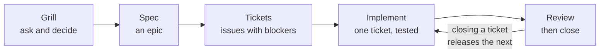

# Quarry

<p align="center">
  
</p>

<p align="center">
  
  
  
</p>

Cut big ideas into work your coding agent can finish, and keep each decision when its context is gone.

Quarry is a plugin for Claude Code, Codex and ZCode. It takes a rough idea to finished,
reviewed work in fixed steps. You make the decisions. The agent does the work. Nothing
depends on what the agent remembers.

## Table of contents

- [Why Quarry](#why-quarry)
- [Install](#install)
- [Usage](#usage)
- [How it works](#how-it-works)
- [Optional companions](#optional-companions)
- [Documentation](#documentation)
- [Support](#support)
- [Maintainer](#maintainer)
- [Thanks](#thanks)
- [Contributing](#contributing)
- [Licence](#licence)

## Why Quarry

A coding agent loses its context when the window fills, when you clear it, and when a
session ends. On a long project this causes three problems:

- **Decisions are made again.** The agent does not know what you decided last week.
- **The plan is in the conversation.** When the conversation is gone, the order of the
  work is gone.
- **You cannot check a claim.** The agent says "we decided X", and you have no record.

Quarry solves these problems with one rule: no state lives in the conversation.

| You get | How |
|---|---|
| Decisions that stay decided | Each decision goes into a file when you make it |
| A plan that needs no memory | Tickets with dependencies. The tracker gives the next one. |
| A record you can check | Each session is sealed, and recall returns the exact lines |
| A view of the work | A local dashboard with a graph, a board and the ready queue |

## Install

### Requirements

| Part | Install |
|---|---|
| Python 3.11 or later | [python.org/downloads](https://www.python.org/downloads/) |
| [bd](https://github.com/gastownhall/beads), the tracker | `npm install -g @beads/bd` |
| [Trail-code](https://github.com/trailhq/Trail-Code), the code atlas | `npm install -g @trailhq/trail-code` |

You can skip bd and Trail-code here. Step 3 proposes each part that is missing.

### 1. Install the plugin

```text
claude plugin marketplace add Renjestoo/quarry
claude plugin install quarry@renjestoo
```

### 2. Tell Quarry which Python to use

Add this to `~/.claude/settings.json`, then restart Claude Code:

```json
{
  "env": { "QUARRY_PYTHON": "<full path of a Python 3.11 or later>" }
}
```

### 3. Set up a repository

In the repository where you want to use Quarry:

```text
/quarry:setup
```

Setup checks the tracker, makes the `.quarry/` folder, and writes the configuration. For
each part that is not ready, it shows the commands and asks you which parts to install.
It installs nothing without your answer.

Setup shows a report of the seven parts. When the install is complete, the report looks
like this (your versions can be different):

```text
Matt Pocock's skills  required  present   0.21.4 (32 skills)
bd                    required  present   1.0.3 (bd)
Trailcode             required  present   0.18.0 (graft)
RTK                   optional  present   0.48.0 (rtk)
task-observer         optional  present   3.12.0
Headroom              optional  present   0.41.0 (headroom)
Graphify              optional  present   0.9.74 (graphify)
doctor: every required part present; exit 0
```

Codex and ZCode get less of Quarry than Claude Code, because they expose fewer events.
See the [compatibility table](quarry/README.md#compatibility).

## Usage

### Start a feature

```text
/quarry:grill add CSV export to the reports page
```

The agent asks you numbered questions, each with a recommended answer. It writes each
decision to a file when you give it. Then continue:

```text
/quarry:spec
/quarry:tickets
/quarry:implement
```

The spec becomes an epic in the tracker. The tickets become issues with blockers. The
agent builds one ticket, with tests and a review, and closes it.

### Continue on a different day

Open a new session. The agent has no memory of the earlier one.

```text
/quarry:workflow
```

Quarry reads the tracker and the files, tells you where the work is, and gives the next
command. `/quarry:ready` lists the tickets that are not blocked.

### Ask what was decided

```text
/quarry:ask why did we choose SQLite and not Postgres
```

Quarry searches the sealed history and returns the exact lines, each with an address such
as `K4:120-135`. The search uses no model, so the same question gives the same answer.

### See the work

```text
/quarry:dashboard
```

A local page shows the dependency graph, a board, the ready queue and the sealed history.

`/quarry:help` prints each skill and command.

## How it works

State has four homes. Each home answers one question.

| Home | Where | Question it answers |
|---|---|---|
| Decisions | Files: `CONTEXT.md`, `docs/adr/` | What did we decide? |
| Work | bd, a tracker with dependencies | What is ready to do now? |
| History | `.quarry/`, the sealed transcripts | What was said before? |
| Code | The atlas, a graph of the repository | Where is the code? |

On these homes, Quarry runs a lifecycle of 32 skills.



Each step writes its result to a home before the next step starts. A sealed unit never
changes, and a SHA-256 check proves that at each recall.

## Optional companions

Quarry needs three parts: its own skills, bd and Trail-code. Four more tools work well
with it. A missing companion stops nothing.

| Companion | What it adds |
|---|---|
| [RTK](https://github.com/rtk-ai/rtk) | Shorter output from shell commands |
| [Headroom](https://github.com/headroomlabs-ai/headroom) | Compression of large content, with retrieval of the original |
| [graphify](https://github.com/Graphify-Labs/graphify) | A graph of documents. The `research` skill queries it. |
| [task-observer](https://github.com/rebelytics/one-skill-to-rule-them-all) | A log of skill improvements. A failed driver stage writes one entry. |

## Documentation

- [Design reference](quarry/README.md): authority, sealing, recall, the dashboard, the
  unattended driver, and what Quarry enforces.
- [Harness parts](quarry/skills/quarry/resources/PARTS.md): what each part does and when
  the agent uses it.

## Support

Found a defect or have a question? [Open an issue](../../issues).

## Maintainer

Renato Kuipers ([@Renjestoo](https://github.com/Renjestoo))

## Thanks

Quarry uses the ideas and the tools of these projects. Thank you to their authors.

| Project | Author | Licence | Part in Quarry |
|---|---|---|---|
| [Skills For Real Engineers](https://github.com/mattpocock/skills) | Matt Pocock | MIT | The source of the lifecycle: grilling, specs, tickets, test-first work, review, triage. Quarry rewrote the skills for its four homes and copied no skill text. |
| [Beads (`bd`)](https://github.com/gastownhall/beads) | Steve Yegge and the Beads contributors | MIT | The tracker. Quarry runs `bd` for each read and write of work state. Required. |
| [Trail-code](https://github.com/trailhq/Trail-Code) (before: Graft) | Trail HQ | MIT | The code atlas. Quarry runs its `graft` command to find code. Required. |
| [RTK](https://github.com/rtk-ai/rtk) | The RTK team | Apache-2.0 for the CLI | Optional. Quarry installs and checks it. |
| [Headroom](https://github.com/headroomlabs-ai/headroom) | Headroom Labs | Apache-2.0 | Optional. Quarry registers its MCP server. |
| [graphify](https://github.com/Graphify-Labs/graphify) | Graphify Labs | Apache-2.0 | Optional. The `research` skill queries its graph. |
| [task-observer](https://github.com/rebelytics/one-skill-to-rule-them-all) | Eoghan Henn / [rebelytics.com](https://rebelytics.com) | CC BY 4.0 | Optional. Quarry runs its `new-observation.sh` script. |

Two more sources:

- **Frozen Context Mesh**: the design source for the seal, distill and recall engine.
- **Space Grotesk** and **JetBrains Mono**: the fonts of the dashboard, under the SIL Open
  Font License 1.1.

Quarry contains no code of the seven projects in the table. It calls the tools that you
install, and each tool has its own licence and its own terms. The two fonts are the only
third-party files in this repository.

## Contributing

Issues and pull requests are welcome. Before a pull request, run the three gates:

```text
python -m ruff check .
python scripts/check_version.py
python quarry/scripts/quarry.py doctor
```

The check scripts are in `quarry/scripts/checks/`. The
[design reference](quarry/README.md#harness) says what each one checks and which runs use
a real model turn.

## Licence

[MIT](LICENSE) © Renato Kuipers
